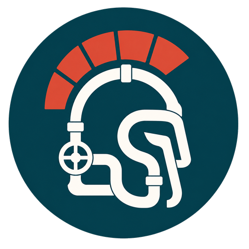

  

<h1 align="center">Hydronicus</h1>

  <strong>Hydronic plant control for Home Assistant.</strong>

Hydronicus is a Home Assistant integration that runs a water-based heating and cooling system: underfloor loops, cooled ceilings, and radiators, fed by a heat pump or a boiler.
You describe the system once, as a Plant: which valves serve which rooms, which pumps move the water, and what heats or cools it.
Hydronicus then opens the valves, runs the pumps, and asks the heat pump for heat or cooling, always in a safe order, and checks that every step really happened.

## Why

When every room's thermostat switches its own valve, nobody is in charge of the pumps and the heat pump.
Pumps run against closed valves, the heat pump short-cycles, and a cooled ceiling sweats.
Hydronicus puts one controller in charge of the whole plant:

- **Safe order.** Valves open first, then the pump starts, then the source is asked; everything stops in reverse.
- **No dry pumps.** A pump that needs an open loop never runs against closed valves.
- **Heating and cooling.** The same loops do both, never at the same time, with a dwell between the two, and an optional automatic changeover.
- **Condensation guard.** Cooled floors and ceilings stay above the worst-case dew point of their rooms.
- **Verified commands.** A command counts only once Home Assistant shows its result; otherwise it is retried and reported as a Repair.
- **Comfort.** Digital thermostats with presets, schedules, away, window handling, bounded early start, and optional learned recovery times.
- **Supply control.** Heat on the heat pump's own curve, a fixed setpoint, or an outdoor heating curve with offset, damping, room influence, and a heating limit; a change made on the heat pump is adopted, not undone.
- **Hot water.** Ownership of the source's DHW switch and target, with a schedule and a disinfection cycle.
- **Care.** Frost protection, and a weekly exercise of idle pumps and valves so they do not seize.
- **Any hardware.** It drives ordinary Home Assistant switches, valves, selects, numbers, and sensors, from whichever integration provides them.
- **Dry run first.** A new Plant only shows what it would do, until you arm its outputs and let it control your equipment.

## What you need

- HACS, and Home Assistant: Hydronicus requires 2026.9.0 or newer.
- Valves and pumps as `switch` or `valve` entities, such as relays.
- A temperature sensor for each zone; for cooling, also a humidity sensor and a supply or surface temperature sensor.
- Optionally, entities that reach your heat pump or boiler: a switch that requests heat or cooling, a select for its mode, and a number for its supply target.
  A [heat pump adapter](adapters/) can provide them; a source that regulates its own water temperature needs none.

## Install

1. In HACS, open the menu and choose **Custom repositories**.
2. Add `https://github.com/brumi1024/ha-hydronicus` with the type **Integration**.
3. Install Hydronicus from HACS and restart Home Assistant.
4. Open **Settings > Devices & services**, choose **Add integration**, and search for **Hydronicus**.

## Get started

1. **Try it without equipment.**
   The [trial kit](docs/examples/trial/) is a Home Assistant package of fake valves, a fake pump, and adjustable temperatures.
   Load it, import [its plant file](docs/examples/trial/plant.yaml), and watch the Plant's **Status** sensor and its proposals while you move the temperatures.
2. **Describe your own Plant.**
   Guided setup asks for the source, the pumps, and each zone form by form.
   You can also import a plant file; [the full example](docs/examples/full-plant.yaml) shows and explains every key, and [the reference plant](docs/examples/reference-plant.yaml) is a realistic starting point.
3. **Watch, then go live.**
   A new Plant runs in Dry run: it sends nothing and records what it would send in the **Status** sensor's `proposed` attribute.
   When the proposals look right, arm the outputs in the Plant's settings and turn on **Control equipment**.

Every Plant can be exported back to a plant file with the `hydronicus.export_plant` action.

## What you get

Each Plant is a device with a **Mode** select (off, heat, cool, and auto with a changeover), a **Status** sensor that says what the Plant does and why, a **Control equipment** switch, and an **Away** switch.
Each zone is a device with a climate entity, its combined temperature, its dew point, and its heating and cooling demand.
Each loop reports whether it is flowing and how long it ran, and the source reports its requests, faults, and compressor starts.
Problems surface as Home Assistant Repairs that say what is wrong and open the form that fixes it.

## Safety

Hydronicus is software coordination, not a safety device.
Keep the physical protections of your plant, such as high-limit thermostats, pressure relief, flow switches, and condensation switches, working without Home Assistant.
Reload, restart, and removal never send a command, so the equipment stays as it was while Hydronicus is not running.
[Safety and limits](docs/architecture.md#safety-and-limits) lists what it does and does not protect.

## Learn more

- [Architecture](docs/architecture.md): how Hydronicus decides, and how the code is laid out.
- [Examples](docs/examples/): plant files and the trial kit.
- [Adapters](adapters/): bridges that expose a heat pump's controls as Home Assistant entities.
- [Contributing](CONTRIBUTING.md): the development environment and the quality gate.
- [Release notes](docs/releases/).

## Getting help

Open an issue with the [diagnostic bug report template](.github/ISSUE_TEMPLATE/diagnostic-bug-report.md), and attach the Plant's diagnostics from **Settings > Devices & services**.
Remove credentials, private addresses, and household details from anything you attach.

## License

[MIT](LICENSE).
