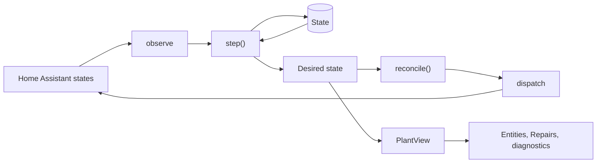

# Architecture

This page explains how Hydronicus works, from the model of a plant to the layout of the code.
It is an overview: the code and its tests are the detailed reference, and [CONTEXT.md](../CONTEXT.md) defines every domain word.

## The model

A **Plant** is one heating and cooling system, set up once as one Home Assistant config entry.
It is made of plain, frozen values addressed by slugs:

| Part | What it is |
| --- | --- |
| Source | The heat pump or boiler, asked for heat or cooling through a request switch, an optional mode select, and an optional supply target number. Optional: a Plant without one still runs valves and pumps. |
| Pump | A circulator that Hydronicus switches, or one the source runs by itself, which Hydronicus never commands. |
| Loop | One water path: zero or more valves that open together, and exactly one pump. It heats, cools, or both. |
| Zone | The space one thermostat controls. It owns its loops and can follow the sensors of Home Assistant areas. |
| Plant loop | A loop that no zone owns, such as a towel dryer that runs with the source, or a hall that two zones share. |

Every output has exactly one role in one Plant: a valve of one loop, a pump's switch, or a source output.
Slugs never change, and unique IDs derive from the Plant ID and the slugs, so a Plant exported and imported again gets the same entity IDs.

The **plant file** is the YAML form of a Plant.
It is what import and export read and write, and it is also the storage schema: the config entry holds the Plant without its zones, and each zone is a config subentry.
[The full example](examples/full-plant.yaml) shows every key.

## The control loop

Hydronicus is a reconciler.
Each evaluation reads the world, computes the state every output should have now, and sends only what differs.

1. **Observe** reads every bound entity into observations: output states, sensor values with their age, thermostats, and the Plant mode.
   Units are converted and implausible values are rejected here.
2. **`step()`** is a pure function of the Plant, the observations, the persisted State, and the time.
   It returns the desired state of every output with every hydraulic wait already in it, a reason for each decision, and the next State.
3. **`reconcile()`** turns the difference between desired and observed into service calls, in dependency order, with at most one call per output in flight, retries with backoff, and the outputs to report as Repairs.
4. **Dispatch** sends those calls from one task, outside the evaluation, and rechecks arming and permission before each one.
5. The runtime persists the State, builds the read model (`PlantView`), publishes the entities, and schedules the next evaluation.

An evaluation runs whenever something it reads changes, and whenever a timer it waits on is due.
Evaluations are coalesced and never await, so they need no lock.
Stopping is the same evaluation with the mode forced to off, so every stop follows the same sequence.

## The safe sequence

When a zone calls, Hydronicus starts its equipment in order, and each step waits for the previous one to be **observed**, not merely commanded:

1. The loop's valves open, and stay open for their opening time before the loop counts as ready.
2. The loop's pump starts.
3. Once the pump is seen running, the mode select shows the right mode, and the supply target is confirmed, the source is requested.

Stopping runs in reverse: the source request is released after its minimum on time, a switched pump runs its overrun after heating, and the valves close once their pump is seen off.
Every pump declares a minimum flow: `guaranteed` when a separator or bypass gives it a path, or `path` when it needs an open loop.
A pump with `path` never runs without one, and a source-driven pump with `path` has a min-flow loop held open whenever it may run.

## Demand

A zone combines its usable temperatures by mean, minimum, or maximum.
A required sensor that is missing, stale, or implausible stops the zone from calling; an optional one is left out.

A zone's demand comes from exactly one thermostat:

- A **digital thermostat** is a climate entity Hydronicus provides, with hysteresis, minimum on and off times, separate heating and cooling targets, presets, and an optional comfort schedule with setbacks and bounded early start.
  Early start can use configured warming rates or, once proven, learned recovery times, optionally refined by a weather forecast.
- An **external thermostat** is an existing climate entity that Hydronicus only reads, through its `hvac_action`.

On top of the thermostat, open windows (from sensors or a sudden temperature drop) stop a zone from calling, away holds every digital thermostat at its away level until a return time, and frost protection heats a zone about to freeze whatever its thermostat says.

## Heating, cooling, and condensation

The Plant **Mode** is off, heat, cool, or auto, and heating and cooling never run at the same time.
A change of mode stops the old mode in the usual order, waits a dwell after the old mode's flow ended, and only then starts the new one.
In auto, a changeover picks the mode from the day's average outdoor temperature, with a neutral band and a minimum time between changes.

A loop may cool only with a condensation reference: its pump's supply temperature or its own surface temperature.
Its guard compares the coldest reference with the zone's worst-case dew point, the dew point of its warmest temperature and its highest humidity, and blocks below a 2 K margin with hysteresis and a minimum block time.
Condensation switches, a surface minimum, and a humidity limit can add to the guard, and none of them relaxes it.
A missing or stale input blocks.

## The source

The source is reached only through generic entities, so Hydronicus does not know the make of the heat pump:

- a **request** switch, and optionally **mode switches** that must be on in a mode;
- an optional **mode** select with the option names for heat and cool;
- an optional **supply** number and **weather curve** switch.
  The **Heating supply** select chooses who owns the heating supply temperature: the heat pump's own curve, a fixed setpoint, or Hydronicus's outdoor curve with offset, damping, room influence, a heating limit, and an outdoor fallback.
  A change made on the heat pump is adopted as the new choice, never undone.
  An optional **curve number** picks which of the heat pump's own curves runs; Hydronicus owns it like the DHW target and adopts a change made on the heat pump.
  A **Warm-up** raises the heating supply for a bounded time, by a shift on a fixed setpoint or Hydronicus's curve or by curve steps on the heat pump's own, and ends early once the zones that called are warm, the Plant cools, or the curve number or strategy is changed.
  Cooling always uses Hydronicus's target, raised to stay above the dew point, with the heat pump's curve off;
- optional **DHW** switch and target, owned by Hydronicus, with boosts, a schedule, and a disinfection cycle proven by the tank sensor;
- optional feedback: running, health, handover, inhibit, and compressor sensors, a no-load guard, and a minimum interval between writes.

The source keeps minimum on and off times from observed request transitions, may limit its starts per hour, may wait for enough loops to call, and may run out its minimum on time into heat sink loops.

## Adapters

A heat pump rarely exposes those entities by itself.
An **adapter** is anything that turns a heat pump's own interface into Home Assistant entities that a Plant can bind: a Modbus bridge, a cloud or local Wi-Fi integration, or an ESPHome device.
Adapters live outside the integration, in [adapters/](../adapters/), and hold no control logic: they read the heat pump, publish its state, and carry out whitelisted writes.
Hydronicus stays the only place that decides.

The contract an adapter meets is the source binding of the plant file:

| Entity | Purpose |
| --- | --- |
| `switch` request | Asks the heat pump for space heating or cooling. |
| `select` mode | Switches between heating and cooling. |
| `number` supply | The water supply target, in °C. |
| `switch` and `number` DHW | Hot water on or off, and its target. |
| `binary_sensor` health and handover | Whether the adapter reaches the heat pump, and whether the heat pump runs on its own controller. |
| `sensor` temperatures and compressor | Supply, return, tank, and compressor frequency, for feedback and the no-load guard. |

An adapter should report state at least once a minute, refuse writes it cannot verify, protect the heat pump's memory from excessive writes, and hand control back to the heat pump's own controller when Home Assistant goes quiet.
[The Midea Shelly Modbus adapter](../adapters/midea-shelly-modbus/) is the first one.

## Commands, arming, and Dry run

A service call that returns is not a confirmation; only the output's state in Home Assistant is.
Until an output shows the result, Hydronicus assumes the worst: a pump asked to stop may still run, so its last open loop stays open.
An unconfirmed call is modeled as possibly acting until its 10-second timeout, and is retried with backoff up to every 5 minutes; after three attempts a Repair names the output and the Plant's status reads `degraded`.

Hydronicus commands an output only while it is **armed** and **Control equipment** is on.
A new Plant has nothing armed and control off, and runs in **Dry run**: it sends nothing, records each command it would send as proposed, and treats the proposal as followed, so the sequence advances just as it would for real.
Dry run checks the configuration and the sequence, not the plant: it simulates no water, pressure, or temperature.

## Lifecycle

Reload, unload, removal, and Home Assistant stop never send a command, and the equipment stays as it is while Hydronicus is not running.
The runtime saves its timers, the Plant mode, when each output last changed, and the reconciler's state, and restores them first, so an unchanged plant gets no command after a restart.

The runtime also saves the last valid Plant with the outputs it was commanding.
When a new configuration removes an output that is on, or is not valid, the first evaluation runs that previous Plant with control forced off until its outputs are seen off, and only then the new one.
A configuration that is not valid then loads as an empty Plant that only observes, with a Repair.

## Code layout

The integration lives in `custom_components/hydronicus/`, split into a pure core and the Home Assistant adapter around it.

`core/` has no Home Assistant imports, so the simulator and the core tests run it directly:

| Module | Role |
| --- | --- |
| `model.py` | The Plant and the desired state, as frozen values. |
| `plant_file.py` | Reading, validating, and writing plant files, and the storage split into entry and subentries. |
| `step.py` | Observations, State, and `step()`. |
| `demand.py`, `comfort.py`, `thermal.py`, `forecast.py` | Zone demand, thermostats, schedules, early start, and learned recovery. |
| `supply.py`, `changeover.py`, `dhw.py`, `response.py` | Supply targets, automatic changeover, hot water, and the zone response check. |
| `reconcile.py` | Desired state to service calls, retries, and Repairs. |

The Home Assistant side:

| Module | Role |
| --- | --- |
| `runtime.py` | Runs one Plant: observe, step, reconcile, dispatch, persist, publish, schedule. |
| `observe.py`, `areas.py` | Reading states and area registries into observations. |
| `dispatch.py` | Sending calls in order, one at a time, within their timeout. |
| `previous.py` | The last valid Plant, which stops removed outputs safely. |
| `view.py`, `presentation.py`, `websocket.py` | The read model, and the Plant view that a dashboard card can subscribe to. |
| `storage.py`, `bindings.py` | The config entry, zone subentries, arming options, and binding rules. |
| `config_flow.py`, `flows/` | Guided setup, import, reconfigure, zone subentries, and Plant settings. |
| `issues.py`, `repairs.py` | Repairs and their fix flows. |
| `entity.py` and the platforms | The published entities. |
| `learning.py`, `forecast.py`, `flow_history.py` | Recovery learning, weather forecasts, and runtime and duty cycle history. |
| `services.py`, `diagnostics.py` | Actions and diagnostics. |

## Testing and invariants

Tests live in three layers: `tests/core/` tests the pure core, `tests/integration/` tests the integration inside a real Home Assistant test harness, and `tests/sim/` runs a plant simulator.
The simulator owns physical state, drives `step()` and `reconcile()` as the runtime does, and checks these invariants after every event of randomly generated plants and traces that delay, reject, or time out commands, restart the runtime, jump the clock, and lose sensors:

1. Dry run and an unarmed output receive zero service calls.
2. A pump with `min_flow: path` never runs without an open path.
3. The source is requested only while a loop of the current mode is ready and, when its pump is switched, that pump is observed running.
4. A source-driven pump with `min_flow: path` has an open path while the source is requested, during its post-run, and while it is observed running.
5. Heating and cooling loops never flow at the same time, and a mode change waits for the old mode to stop and for the dwell.
6. A cooling loop flows only while its condensation guard permits.
7. Every difference between desired and observed state is eventually resolved or reported as a Repair.
8. With unchanged observations, the first evaluation after a reload or restart sends no command.
9. Removing an object first stops the equipment it removes, and a configuration that is not valid stops in order and then only observes.
10. The core has no Home Assistant imports and at least 90 percent test coverage, and the whole package passes mypy.
11. Exporting a Plant and importing the file reproduces the Plant and its entity IDs.

`make verify` runs lint, format, type checks, the release check, and every test; [CONTRIBUTING.md](../CONTRIBUTING.md) has the commands.

## Safety and limits

Hydronicus is the second layer of protection, not the first.
It runs the equipment in a sensible order and refuses what it can see is wrong, but it is not a boiler safety controller, a flow proving device, a condensation sensor, a high-limit thermostat, or an emergency stop.
Keep the physical protections of the plant working without Home Assistant, and never use Hydronicus to bypass a hardware interlock.

- A required sensor that is lost stops its zone from calling, unless the zone has an opt-in sensor fallback, which heats it for a bounded share of time.
  An unavailable window sensor reads as closed, so a lost sensor never leaves a home unheated.
- Frost protection is for rooms, not pipes: it acts only while Home Assistant runs and the zone's sensors report.
  Keep the source's own frost protection wherever pipes can freeze.
- The condensation guard exists only while Home Assistant runs, and a supply temperature is not the coldest point of a ceiling.
  When cooling, add a hardware condensation switch, a relay watchdog refreshed from the **Heartbeat** sensor, and the heat pump's own minimum cooling supply temperature.
- The 10-second command window is a software boundary.
  Check real device latency and ordering when commissioning, and keep independent hydraulic and electrical interlocks.
- Removing the whole Plant does not stop its equipment; turn off **Control equipment** first.
- Running, flow, runtime, and duty cycle readings are observations and estimates, not heat or energy measurements.

Commission one step at a time: try the trial kit, run your Plant in Dry run and check its proposals, arm an output only once you have checked it is the right device, and stay near the plant the first time **Control equipment** is on.
